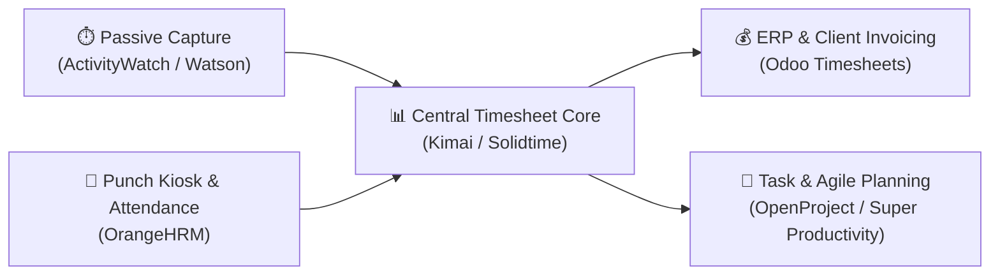

  

  
  
  
  
  
  
  

---

# ⏱️ Awesome Time Card Management

A carefully curated repository tracking notable **SaaS platforms** and **open-source projects** for **Time Card Management**, **Timesheet Tracking**, **Project Billing**, and **Workforce Time Intelligence**.

Whether you run an agile agency, manage enterprise payroll across global jurisdictions, or seek a sovereign self-hosted stack to avoid recurring per-seat fees, this ecosystem guide provides deep visibility into market leaders, pricing tiers, free limits, and open-source alternatives.

---

## 📑 Table of Contents

- [🌐 Sector Overview & Market Dynamics](#-sector-overview--market-dynamics)
- [🏢 SaaS & Hosted Time Card Platforms](#-saas--hosted-time-card-platforms)
- [💻 Open-Source Time Card & Timesheet Projects](#-open-source-time-card--timesheet-projects)
- [🛠️ Recommended Architecture Stacks](#️-recommended-architecture-stacks)
- [🤝 How to Contribute](#-how-to-contribute)
- [💖 Support & Sponsoring](#-support--sponsoring)
- [📈 Star History](#-star-history)
- [⚖️ Disclaimer & Compliance](#️-disclaimer--compliance)

---

## 🌐 Sector Overview & Market Dynamics

The global Time Card & Workforce Time Management software market is valued at approximately **$3.2 Billion in 2025** and is projected to expand to **$6.8 Billion by 2030**, reflecting a sustained compound annual growth rate (CAGR) of **~14.2%**. This momentum is driven by hybrid and distributed workplace operational shifts, stricter statutory labor recordkeeping requirements (such as the EU Working Time Directive and FLSA/DCAA audit benchmarks), and enterprise demand for real-time project profitability telemetry.

The market structure is **moderately fragmented**: mega-cap enterprise ERP and ITSM titans (*ServiceNow*, *Intuit/QuickBooks*, *Deltek/Replicon*) command high-margin Fortune 500 contracts and core payroll integrations, while agile mid-market SaaS solutions (*Clockify*, *Harvest*, *Toggl Track*, *Hubstaff*) compete vigorously for SMBs and creative agencies. Simultaneously, privacy-conscious engineering organizations are adopting self-hosted open-source software (*Odoo*, *Super Productivity*, *Solidtime*, *Kimai*) to retain absolute data custody and eliminate per-seat SaaS tax.

---

## 🏢 SaaS & Hosted Time Card Platforms

The table below outlines leading commercial time card and timesheet systems, sorted in **descending order by company size** (market capitalization or enterprise valuation).

| 🏷️ Product / Platform | 🏢 Company Size (Revenue / Valuation) | 💵 Starting Tier Pricing | 🎁 Free Tier / Trial Limits | 🚀 Key Capabilities & Target Use Case |
| :--- | :--- | :--- | :--- | :--- |
| **[ServiceNow Time Card Management](https://www.servicenow.com/)** | **~$185.0B Market Cap** • ~$10.0B Annual Revenue • *NYSE: NOW* | **~$100.00 /user/month** *(Part of SPM enterprise package; min ~$10k/yr annual contract)* | **14-day free Personal Developer Instance (PDI)** via developer portal with full SPM/Time Card capabilities; hibernates after 10 days of inactivity; no perpetual production free tier | Enterprise time logging against project tasks, IT services, and GRC audit controls; automated approval hierarchies and cost-center allocations for Global 2000 enterprises. |
| **[QuickBooks Time](https://quickbooks.intuit.com/time-tracking/)** | **~$180.0B Market Cap** • ~$16.3B Annual Revenue • *NASDAQ: INTU* | **$10.00 /month base fee** + **$8.00 /user/month** *(Premium plan; Elite at $20 + $10/user/mo)* | **30-day fully functional free trial** with unlimited users and GPS geofencing; no credit card required; no perpetual free tier | Mobile time card punch-clock, GPS geofencing, real-time job costing, and bi-directional synchronization with QuickBooks Payroll. |
| **[Replicon](https://www.replicon.com/)** | **~$58.0B Market Cap** *(Parent: Roper Technologies, NYSE: ROP)* • Deltek ~$1.3B Revenue | **$6.00 /user/month** *(Time & Attendance; 5-user minimum = $30.00/mo)* | **14-day guided free trial** for standard attendance and project tracking modules (up to 10 test users); no perpetual free tier | Global workforce time governance, multi-jurisdiction labor compliance across 145+ countries, AI-powered ZeroTime activity capture, and CloudClock biometric kiosks. |
| **[Clockify](https://clockify.me/)** | **~$200M Valuation** • ~$35M Annual Revenue • *CAKE.com* | **$3.99 /user/month** *(Billed annually; $4.99 billed monthly for Basic)* | **Free forever plan** capped at **5 active users**; includes unlimited projects and time tracking, but restricts reports to 31-day date ranges and PDF exports only (no billable rates or invoicing on free tier) | High-adoption cloud time card and timesheet suite with pomodoro timers, kiosk modes, cross-platform apps, and extensive webhooks. |
| **[Harvest](https://www.getharvest.com/)** | **~$150M Valuation** • ~$30M Annual Revenue • *Riverwood Capital* | **$10.80 /user/month** *(Billed annually; $12.00 billed monthly for Pro)* | **Free forever plan** strictly limited to **1 seat and 2 active projects**; or **30-day unrestricted trial** of Pro plan with unlimited seats and projects (no credit card required) | Visual project budget burndowns, billable vs. non-billable hour analytics, team capacity forecasting, and one-click invoice generation from logged timesheets. |
| **[Toggl Track](https://toggl.com/track/)** | **~$120M Valuation** • ~$25M Annual Revenue • *Toggl* | **$9.00 /user/month** *(Billed annually; $10.00 billed monthly for Starter)* | **Free forever plan** capped at **3 users** with unlimited timers, calendar sync, and personal reports (excludes billable rates, team dashboards, and CSV exports); or **30-day trial** of Premium | Frictionless one-click timer tracking across desktop, browser, and mobile with idle detection, automated background triggers, and timeline views. |
| **[Hubstaff](https://hubstaff.com/)** | **~$100M Valuation** • ~$22M Annual Revenue • *WestBridge Capital* | **$4.99 /user/month** *(Billed annually; min 2 users = $9.98/mo; $7.00/mo monthly)* | **Free forever plan** strictly limited to **1 user and 3 clients**, capped at **100 screenshots/month** with basic timesheets; or **14-day unrestricted trial** of paid plans | Distributed team time card monitoring with optional keyboard/mouse activity metrics, GPS fleet routes, automated payroll generation, and job site geofencing. |
| **[Time Doctor](https://www.timedoctor.com/)** | **~$80M Valuation** • ~$18M Annual Revenue • *Staffing.com* | **$5.90 /user/month** *(Billed annually; $7.00 billed monthly for Basic)* | **14-day free trial** unlocking all Premium tier features (video screen capture, executive dashboards, AI benchmarks) for unlimited users; no credit card required; no perpetual free tier | Workforce productivity intelligence, web/app usage auditing, distraction popups, client verification, and automated payroll calculations for remote staff. |
| **[ClickTime](https://www.clicktime.com/)** | **~$50M Valuation** • ~$12M Annual Revenue • *ClickTime Inc.* | **$10.00 /user/month** *(Billed annually; $13.00 billed monthly for Starter)* | **14-day free trial** on Starter and Team tiers with unlimited test users and sample datasets; no credit card required; no perpetual free tier | Mid-market resource planning, timesheet approval pipelines, employee overtime auditing, billable utilization dashboards, and nonprofit DCAA grant compliance. |
| **[Everhour](https://everhour.com/)** | **~$35M Valuation** • ~$8M Annual Revenue • *Everhour LLC* | **$5.00 /user/month** *(Billed annually; min 2 users = $10.00/mo; $6.00/mo monthly for Lite)* | **Free forever plan** capped at **5 users** with basic web time tracking and simple export reports, but strictly excludes all third-party integrations and billable rates; or **14-day full Pro trial** | Seamless embedded time tracking that natively injects stopwatch widgets directly into Jira, Asana, Trello, ClickUp, GitHub issues, and Notion pages. |

---

## 💻 Open-Source Time Card & Timesheet Projects

Active open-source repositories for self-hosted timesheets, developer time cards, and sovereign workforce tracking. Sorted in **descending order by GitHub Stars_Count**.

- **[Odoo Timesheets](https://github.com/odoo/odoo)**   
  *Enterprise ERP suite with comprehensive native Timesheets, project time allocation, overtime tracking, approval workflows, and billable client invoicing.*

- **[Super Productivity](https://github.com/super-productivity/super-productivity)**   
  *Advanced personal time-tracking and todo app with built-in timeboxing, automatic break reminders, and direct sync with Jira, GitHub, GitLab, and OpenProject.*

- **[ActivityWatch](https://github.com/ActivityWatch/activitywatch)**   
  *Automated, privacy-first local time tracker that passively monitors application windows and active documents across Windows, macOS, Linux, and Android.*

- **[OpenProject](https://github.com/opf/openproject)**   
  *Open-source project management platform featuring integrated time card logging, work package timesheets, cost reporting, and project budgeting.*

- **[solidtime](https://github.com/solidtime-io/solidtime)**   
  *Modern open-source time tracking application built for freelancers and teams; features project time allocation, billable hourly rates, client tagging, and multi-organization support.*

- **[Kimai](https://github.com/kimai/kimai)**   
  *The #1 dedicated open-source multi-user time tracking and timesheet platform; features multi-currency invoicing (PDF/XLSX), role-based approvals, budget alerts, and LDAP/SAML.*

- **[Worklenz](https://github.com/Worklenz/worklenz)**   
  *All-in-one project management and time card tracking tool for efficient engineering teams; combines task kanban boards with live task timers and resource workload planning.*

- **[Watson](https://github.com/jazzband/Watson)**   
  *Wonderful, fast CLI time tracker written in Python; supports project and tag grouping, frame editing, and detailed terminal reports.*

- **[TimeTagger](https://github.com/almarklein/timetagger)**   
  *Open-source time tracking application centered on an interactive visual timeline; provides instant time card inspection, tag analytics, and calendar integration.*

- **[Timewarrior](https://github.com/GothenburgBitFactory/timewarrior)**   
  *Command-line time tracker that integrates with Taskwarrior; tracks activity intervals, detects overlapping sessions, and generates tabular and graphical reports.*

- **[Traggo](https://github.com/traggo/server)**   
  *Self-hosted tag-based time tracking server with a clean web dashboard and GraphQL API, eliminating rigid project hierarchies in favor of dynamic tagging.*

- **[OrangeHRM](https://github.com/orangehrm/orangehrm)**   
  *Comprehensive open-source HRM system with full employee time & attendance, timesheet approval workflows, punch-in/out kiosks, and leave policy enforcement.*

- **[Hamster](https://github.com/projecthamster/hamster)**   
  *Classic open-source GNOME time tracking application for desktop work logging, task categorization, and productivity evaluation.*

- **[klog](https://github.com/jotaen/klog)**   
  *Command-line time tracking based entirely on plain-text files; version-controllable with git, human-readable, and free from database overhead.*

- **[titra](https://github.com/titraio/titra)**   
  *Modern open-source project time tracking tailored for agencies and freelancers, built on Meteor and React with instant time entry and clean reporting.*

- **[Urlaubsverwaltung](https://github.com/urlaubsverwaltung/urlaubsverwaltung)**   
  *Open-source, self-hosted working time capture, absence management, overtime verification, and vacation planning built for European workplace compliance.*

- **[Miru](https://github.com/saeloun/miru-web)**   
  *Open-source time tracking, client invoicing, and employee benefits management application built with Ruby on Rails and React.*

---

## 🛠️ Recommended Architecture Stacks

For organizations designing a self-hosted time card and project billing architecture, consider combining these specialized open-source components:

- **For Freelancers & Solo Builders**: Combine **Watson** or **klog** for local terminal time capture with **Solidtime** or **TimeTagger** for client reporting.
- **For Consultancies & Agencies**: Deploy **Kimai** or **Miru** for client project rate tracking, multi-user approvals, and PDF billing.
- **For Enterprise & Regulated Workforces**: Deploy **Odoo Timesheets** or **OrangeHRM** alongside **Urlaubsverwaltung** for audit-proof labor regulation compliance.

---

## 🤝 How to Contribute

Contributions are welcome! Help keep this ecosystem comprehensive, factual, and up to date:

1. **Fork this repository** to your GitHub account.
2. **Add or update entries** in `README.md` following the existing format:
   - For SaaS tools: include Product, Company Size, Starting Price, Free Tier Limits, and Core Features.
   - For Open-Source tools: include repo link, Stars_Badge, and an accurate one-sentence technical summary.
3. Verify that links are direct and descriptions remain neutral and objective.
4. **Submit a Pull Request** with a concise summary of changes.

---

## 💖 Support & Sponsoring

Thank you for visiting and supporting the **Awesome Time Card Management** ecosystem! If you find this curated collection helpful for your team, organization, or personal workflow:

- ⭐ **Star this repository** on GitHub to show your appreciation and help others discover it.
- 🍴 **Fork the repo** to contribute new SaaS platforms or open-source tools.
- 📢 **Share it** with fellow developers, HR managers, and project leaders.
- ☕ **Sponsor & Buy a Coffee**: Support ongoing curation and maintenance by visiting the [GitHub Sponsor Dashboard](https://github.com/sponsors/ishandutta2007).

---

## 📈 Star History

---

## ⚖️ Disclaimer & Compliance

- This repository is a **community-curated index** created for educational, architectural, and informational purposes; inclusion does not constitute an endorsement.
- Time card management platforms handling employee attendance, location, and activity telemetry must comply with applicable data protection laws (such as GDPR, CCPA, and CPRA) as well as national labor standards (FLSA, DCAA, EU Working Time Directive).
- Self-hosted open-source software deployments require proper access control, transport layer encryption, scheduled backups, and integration audits before handling production payroll data.
- Always review repository licenses for commercial distribution constraints (e.g., AGPL-3.0, GPL-2.0, LGPL, and MIT).

---

  Curated with ❤️ for freelancers, agencies, HR leaders, and software teams worldwide. 
  Discover more awesome lists at <a href="https://github.com/ishandutta2007/Awesome-Awesome-Awesome">Awesome-Awesome-Awesome</a>.

